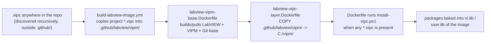

# Baking VIPM (VIPC) dependencies into the CI workers

This folder holds everything the Windows CI worker needs to install **VIPM**
(JKI VI Package Manager) packages into the LabVIEW container image at build time,
so that a project's custom dependencies — declared in a `.vipc` configuration —
are already present when CI jobs (unit tests, VI Analyzer, documentation, …) run.

It exists because some CI operations link against VIPM-distributed libraries that
are **not** part of the bare NI LabVIEW image. The most important example: the
built-in `LabVIEWCLI -OperationName RunUnitTests` operation links against NI's
**UTF JUnit Report** library (`ni_lib_utf_junit_report`). Without it, headless
unit-test runs fail with **LabVIEW CLI error `-350053`** and CI reports a
false "no unit tests found".

---

## Files

| File | Role |
| --- | --- |
| `install-vipc.ps1` | Build-time hook. Uses the VIPM CLI already present in the shared VIPM base image, launches headless LabVIEW, then installs the packages listed in every staged `*.vipc`. A failed bake fails the image build unless `VIPM_ALLOW_MISSING_PACKAGES=1` is explicitly set. |
| `install-vipc-linux.sh` | Linux build-time hook. Starts Xvfb and headless LabVIEW, clears the runtime-only `LV_RTE_HEADLESS` default while the VIPM engine starts, extracts each VIPC's `config.xml`, installs the resulting `name@version` specs with the VIPM 26.3 CLI, forces phase progress in CI logs, and prints focused process/display diagnostics when a package action fails. |
| `ci-tooling.vipc` | The default CI-tooling configuration (Caraya, VI Tester, LUnit base + CLI, UTF JUnit Report, G Image). This committed file is the **source of truth** and must remain VIPM-openable. Edit it in VIPM when changing dependency intent. |
| `ci-tooling.packages.json` / `ci-tooling.defaults.json` | Optional metadata and automation inputs used by dashboards/config tools and by ad-hoc regeneration. They are **not authoritative** for what gets installed at build time. |
| `build-tooling-vipc.py` | Optional helper to build a real VIPM-openable VIPC from JSON inputs. It resolves each package (and its dependency closure) against the public VIPM indexes and downloads each package's real spec + icon. Stdlib only, but **requires network** to the public indexes. |

---

## How a `.vipc` gets baked in (the pipeline)



The expensive, slow-moving tooling layer is published separately as
`ghcr.io/<owner>/<repo>-labview-vipm-base:<labview-year>`. That image already
contains VIPM 2026 Q3 and Git. Project worker rebuilds start from it and only
apply the staged VIPC files, so changing a dependency set does not reinstall VIPM.

Validated proof path (2026-06-21): the manual `bake-vipc-windows-base.yml` run
created/pulled `ghcr.io/elijah286/labview-ci-with-containers-labview-vipm-base:2026`,
built the thin VIPC layer from `example/Dependencies.vipc`, verified the seven
expected packages with `vipm list --installed` inside the resulting image, and
pushed `ghcr.io/elijah286/labview-ci-with-containers-labview:2026` plus the
`vipc-base` tags. In other words, the Windows base image now stores VIPM/Git;
VIPC changes are applied on top as a project dependency layer.

A repository that "features a `.vipc`" therefore gets that configuration baked
into the Windows worker automatically — the build workflow copies any project
`*.vipc` found anywhere in the repo (recursively, outside `.github/`) into this
folder before building. The container-based CI activities (VI Analyzer, Mass
Compile, Unit Tests, Antidoc, VIDiff) then **wait** for that worker image rebuild
to finish — via `.github/labview/wait-for-worker-images.sh` — before they pull the
image and run, so they never execute against a worker that is missing a project
dependency. The `ci-tooling.vipc` distributed by the tooling is the **base**
configuration applied first; a project's own discovered VIPC files stack on top.

### Required essentials vs. best-effort tooling

`install-vipc.ps1` does not treat all packages equally, because a single heavy
add-on must never be able to break the whole worker:

1. **Required unit-test essentials, installed FIRST.** Before any VIPC is applied, the
   script installs Caraya (`jki_lib_caraya@1.4.4.148`) and the UTF JUnit reporter set (`ni_lib_utf_junit_report`,
   `ni_lib_junit_results_api`, `ni_lib_simple_xml`) while the engine is fresh.
   These are what the built-in `RunUnitTests` CLI links against; without them
   headless UTF fails with `-350053`; a Caraya runner with missing framework VIs
   can fail to open with error `1003`. A failure here **fails the build**, and the
   final worker Docker hook propagates the installer's nonzero exit. Override
   the list with the `VIPM_REQUIRED_PACKAGES` env var (set it to `-` to disable).
2. **Project VIPCs are required.** Any discovered project `*.vipc` (the OpenG /
   domain dependencies the project's VIs load against) must install or the build
   fails.
3. **Tooling VIPCs (`ci-tooling*.vipc`) are best-effort.** Their add-ons
   (Antidoc, LUnit base + CLI, VI Tester) are opportunistic: if one wedges
   the headless VIPM engine — Antidoc's large dependency tree is the known offender
   — the script warns and continues, and the image is still published. The required
   essentials above are already installed. A seed-only worker copy does not apply
   this install hook; rebuild the project worker to bake Caraya and its required
   project dependencies. Bake a wedge-prone
   add-on from its own dedicated VIPC if you need it guaranteed in the worker.

This ordering is why the main `build-labview-image.yml` produces a working,
UTF-capable image even when Antidoc cannot currently be baked headless.

To add **custom** project dependencies: commit a `.vipc` (typically created in
the VIPM editor) at the repo root or under
`.github/labview/vipm/`, then rebuild the image. No script changes are needed.

### Baking a package that is on no VIPM repository (commit its `.vip`)

A package published on **no** VIPM repository — e.g. an in-house framework — cannot
be resolved by name from the public indexes. Rather than standing up a private VIPM
mirror, **commit the package's `.vip` file to the repo** and reference the package in
a `.vipc`:

1. Commit the `.vip` anywhere outside `.github/` (the build stages every repo `*.vip`
   into `.github/labview/vipm/`, next to the VIPCs). Keep VIPM's canonical export name
   `<package-id>-<version>.vip` so its id + version are read correctly.
2. Reference that package (id + version) in a `.vipc` you apply (a project
   `Dependencies.vipc` or `ci-tooling`). The `.vipc` must also list the package's
   dependency closure (OpenG, etc.), because dependencies are **not** read out of the
   committed `.vip` — they are resolved from the `.vipc` like any other package.

When applying that `.vipc`, `install-vipc.ps1` uses the committed `.vip` **in preference
to the public mirror** (and it is the only way a no-index package resolves at all). A
committed `.vip` that is **not** referenced by any applied `.vipc` is never installed on
its own.

---

## What we learned getting VIPM to run headless in a Windows container

These are the non-obvious requirements. Each one was a distinct failure mode we
hit and fixed; keep them in mind when changing the install path.

### 1. Use VIPM 2026 Q3 (26.3) or newer — not the NI-feed `ni-vipm`

The NI Package Manager feed ships an **older** VIPM (`2026.1.0`) whose CLI cannot
complete a headless package install in a Windows container: its `library_list`
call into LabVIEW times out (~330 s) and the old CLI does **not** surface the
underlying error. The **2026 Q3** build (`26.3.3954`) surfaces underlying install
errors and improves headless/container support.

The Dockerfile now downloads the official installer from the JKI CDN and runs it
silently:

```
https://traffic.libsyn.com/secure/jkinc/vipm-26.3.3954-windows-setup.exe
```

It is a standard InstallShield setup — `/exenoui /qn` runs it fully silent
(per <https://docs.vipm.io/latest/installation/>). Override the URL with the
`VIPM_INSTALLER_URL` build-arg / env var to pin a different version.

### 2. No VIPM Pro license is required — but the current container resolver has a bug

The target path is VIPM Free/Community Edition: no VIPM Pro serial is required or
accepted as a prerequisite for this repo. Pro activation is still attempted
automatically if the optional `VIPM_SERIAL_NUMBER` / `VIPM_FULL_NAME` /
`VIPM_EMAIL` secrets are supplied, but the normal path uses the Free/Community
CLI.

Important current limitation (VIPM 26.3.3954): JKI's public Docker example says
container use currently requires Pro activation and that Free/Community support
is intended but still being fixed. Our tests match that: on a normal desktop
Free install, `vipm refresh --force -v` downloads the NI Tool Network and VIPM
Community indexes plus package specs, and `vipm search` resolves packages. In a
Windows Server Core `docker build`, the same Free/Community refresh reports
success but does not download those indexes/specs, so `vipm install <name>` exits
`3` (`PACKAGE_NOT_FOUND`) for every community package.

To keep CI unblocked without a Pro license, `install-vipc.ps1` keeps the official
path first (`vipm refresh`, `vipm install <file.vipc>`, then by-name installs),
then falls back to a resolver-bypass path when the VIPM index is empty: it
downloads the public repository indexes directly, resolves the VIPC package list
and transitive dependencies, downloads the corresponding `.vip` / `.ogp` package
files, validates ZIP magic and MD5 when the index provides one, and installs
those local files with `vipm install <file>`. This bypasses package *discovery*
only; VIPM still performs the actual LabVIEW package install.

The fallback currently knows the two built-in public repositories:

- NI LabVIEW Tools Network: `http://download.ni.com/evaluation/labview/lvtn/vipm/index.vipr`
- VIPM Community: `http://www.jkisoft.com/packages/jkisoft.ogpd`

It also maps the legacy VIPC alias `jki_vi_tester` to the repository package ID
`jki_labs_tool_vi_tester` and translates old OpenG `sf://opengtoolkit/...`
package URLs to SourceForge download URLs.

**The catch (VIPM 26.3):** Community Edition only installs packages when the
**current working directory is inside a _public_ Git repository**. Run it anywhere
else and every install aborts instantly with exit `6`:

```
error: Not inside a Git repository: no git repository found
VIPM Community Edition requires a public Git repository. Upgrade to VIPM
Professional for use outside of public repositories: https://vipm.io/pro
```

During `docker build` the installs run from `C:\vipm` (just the copied scripts),
which is **not** a Git repo — so they were all blocked. VIPM determines the
repository and its visibility by **shelling out to a real `git` binary** (it runs
`git` to read `.git/config`'s `origin` URL and to confirm the repo is public). It
needs **no clone and no commits**, but it _does_ need a git executable on `PATH`
— without one it fails with a second flavour of exit `6`:

```
error: Cannot determine repository visibility: failed to execute
git: program not found
```

The Windows base image ships **no git**, so the Dockerfile installs full Git for
Windows first and falls back to portable MinGit. `install-vipc.ps1` then prefers a
real shallow clone of the public repository, falls back to a minimal fabricated
`.git` if cloning is unavailable, `cd`s into it, runs the installs, and deletes it
afterward. The repo URL comes from the `VIPM_PUBLIC_REPO_URL` build-arg / env var
(the build workflow passes the actual building repo via
`${{ github.server_url }}/${{ github.repository }}.git`, so a fork uses its own
public repo); it defaults to this repo.

Minimal `.git` that satisfies the check:

```
.git/HEAD      ->  ref: refs/heads/main
.git/config    ->  [remote "origin"]
                       url = https://github.com/<owner>/<public-repo>.git
.git/objects/  (empty)
.git/refs/heads/  (empty)
```

### 3. Run the CLI non-interactively

Set so the CLI never blocks waiting for a prompt and emits clean logs:

- `VIPM_NONINTERACTIVE=1` — auto-confirm; error (don't hang) on missing params.
- `VIPM_ASSUME_YES=1` — explicit "yes" to confirmations.
- `NO_COLOR=1` — no ANSI color codes in CI logs.

### 4. VIPM needs `Settings.ini`

`vipm install` reads `C:\ProgramData\JKI\VIPM\Settings.ini` for its target
LabVIEW configuration and aborts with *"IO error: Failed to load …Settings.ini …
(os error 2)"* if it is missing. A fresh image that never launched VIPM
interactively won't have it, so `install-vipc.ps1` **seeds a minimal
`Settings.ini`** (target name/version/location/VI-Server port `3363`) when it is
absent. The proper installer may also create it; the seed only writes if missing.

### 5. LabVIEW must be running headless before `vipm install`

The modern CLI installs packages **into a running LabVIEW** over VI Server. The
script launches LabVIEW with `--headless` (works on Windows and Linux) and waits
for the VI Server port (`3363`) to accept connections before installing, then
stops it afterward. Without this, the install has nothing to install into.

### 6. Mind the operation timeouts during `docker build`

VIPM auto-detects CI environments (`GITHUB_ACTIONS`, `CI`, …) and uses **longer**
default timeouts there. **But during `docker build` those env vars are not
present**, so VIPM falls back to its **short** defaults
(`check_for_updates` ~270 s, `library_list` ~330 s), which can abort a cold,
first-run headless LabVIEW before it finishes responding.

Fix: set **`VIPM_TIMEOUT`** (seconds) to override the default/CI-adjusted
timeout. The script sets `VIPM_TIMEOUT=900`. See
<https://docs.vipm.io/latest/cli/environment-variables/>.

If `vipm refresh --force` reports `wait for VIPM startup`, the Desktop engine
is unresponsive and package installs will hit the same timeout. The script
restarts the headless LabVIEW/VIPM stack once (`VIPM_MAX_REFRESH_RESTARTS=1` by
default); if the refresh handshake still fails, it stops before attempting any
packages.

Two known causes, one symptom — increasing `VIPM_TIMEOUT` or changing the
dependency declaration helps with neither:

1. **A global headless default.** The VIPM Desktop engine is a LabVIEW-runtime
   app: with `LV_RTE_HEADLESS=1` in its environment it runs but never completes
   the CLI's startup handshake. The worker base bakes that variable for
   g-cli/Antidoc, and it silently broke **every** Windows dependency bake from
   2026-08-01 to 2026-08-21 (probe-proven: the same base passes the moment the
   variable is cleared). The script now clears it for its own process tree;
   see the preflight/launch sections.
2. **Container memory.** The engine's package-list refresh alone peaks over
   1.3 GB on LabVIEW 2026 Q3; a memory-capped build container (Windows `docker
   build` can default to a low cap, unlike `docker run`) starves it into the
   identical wedge. The build workflows pass `docker build -m 8GB`, and the
   script's memory preflight fails fast with this diagnosis when less than
   ~2.5 GB is visible.

### 7. CLI command shape (26.3 Rust/clap CLI)

Verified against `vipm install --help` and the
<https://docs.vipm.io/latest/cli/command-reference/> reference. **The 26.3 CLI
changed shape vs. the older `2026.1.0` build — mind the differences:**

- Install by name with a pinned version using **`@`**:
  `vipm install ni_lib_utf_junit_report@1.0.1.43`
  (the hyphen form `pkg-1.2.3.4` is misread as a file path).
- **Global** options (place them **before** the `install` subcommand):
  `--labview-version <YYYY>`, `--labview-bitness <32|64>`, `--timeout <SECONDS>`,
  `--json`, `--color-mode auto|always|never`, `-v/--verbose`. They are accepted
  on every command; the script calls
  `vipm --labview-version 2026 --labview-bitness 64 install <pkgs>`.
- **`--refresh` was removed** from `install` (it existed as a global option on
  `2026.1.0`). 26.3 refreshes the package list with a **separate**
  `vipm refresh` command, which the script runs once before installing. Passing
  `--refresh` to `install` now fails with exit `2` (`COMMAND_SYNTAX_ERROR`:
  *"unexpected argument '--refresh' found"*).
- `-y` / `--yes` **does** exist in 26.3 (skips the confirm prompt when installing
  **from a file**), but the script relies on the `VIPM_NONINTERACTIVE` /
  `VIPM_ASSUME_YES` env vars instead, so it isn't needed.
- The Linux hook adds `--show-progress --verbose` so a CI log records whether a
   package is resolving, extracting files, or running its own post-install action.
   These flags add observability only; they do not bypass package scripts.
- The `config.xml`-only `.vipc` produced by VIPM/project tooling is **not**
  reliably accepted by `vipm install <file.vipc>` directly in a Windows Server
  Core build. VIPM can return exit `0` while printing `No packages were installed`.
  Treat that as a failed/no-op apply. The script then parses package names out of
  the `.vipc`, tries by-name installs, and finally falls back to direct public
  index downloads plus local `.vip` / `.ogp` file installs. The local-file install
  path is the one that successfully verified the OpenG dependency VIPC in the
  container.

---

## Environment variables (read by `install-vipc.ps1` / the Dockerfile)

| Variable | Default | Purpose |
| --- | --- | --- |
| `VIPM_INSTALLER_URL` | `…/vipm-26.3.3954-windows-setup.exe` | VIPM installer to download if the CLI isn't already present. |
| `VIPM_COMMUNITY_EDITION` | _(unset)_ | Optional override. Do not force it unless you specifically need to exercise the Community public-repo entitlement gate. |
| `VIPM_NONINTERACTIVE` | `1` | Never block on prompts. |
| `VIPM_ASSUME_YES` | `1` | Auto-confirm. |
| `VIPM_TIMEOUT` | `900` | Override the per-operation timeout (seconds). |
| `VIPM_DESKTOP_LIVELINESS_TIMEOUT` | `900` (Linux) | Maximum silent interval while the VIPM Desktop engine performs a package operation. |
| `VIPM_DEBUG` | `1` (Linux) | Ask the CLI for diagnostic detail alongside the Linux hook's forced progress output. |
| `VIPM_MAX_REFRESH_RESTARTS` | `1` | Number of clean LabVIEW/VIPM restarts after a refresh startup-handshake timeout. Set to `0` to fail immediately. |
| `VIPM_ALLOW_LOW_MEMORY` | _(unset)_ | Set to `1` to attempt the install even when the container shows <~2.5 GB of memory (the preflight otherwise fails fast, since the VIPM engine cannot start under the Windows `docker build` default memory cap). |
| `VIPM_DESKTOP_LIVELINESS_TIMEOUT` | `= VIPM_TIMEOUT` (900) | Seconds of Desktop silence the CLI tolerates before declaring `made no progress ... VIPM Desktop may be stuck` (its default is 60s). Large packages (e.g. `wovalab_lib_asciidoc_for_labview`) run post-install actions that are silently busy for minutes; the script raises this to the per-operation timeout so a healthy install is not aborted. |
| `VIPM_REQUIRED_PACKAGES` | Caraya + UTF JUnit essentials | Comma/semicolon list of `name@version` installed FIRST as required (build fails if they fail). Default: `ni_lib_utf_junit_report@1.0.1.43,ni_lib_junit_results_api@1.0.1.6,ni_lib_simple_xml@1.0.0.4,jki_lib_caraya@1.4.4.148`. Set to `-` to disable the required pre-install. |
| `VIPM_PUBLIC_REPO_URL` | this repo's clone URL | Public Git repo `origin` used to satisfy Community Edition's public-repo requirement. |
| `VIPM_ALLOW_MISSING_PACKAGES` | _(unset)_ | Set to `1` only for emergency best-effort builds; otherwise a failed REQUIRED package fails the image build. (Best-effort `ci-tooling*.vipc` add-ons never fail the build regardless.) |
| `GIT_INSTALLER_URL` | Git for Windows 2.54.0 installer | Full Git for Windows installer used before the MinGit fallback. |
| `NO_COLOR` | `1` | Strip ANSI color from logs. |
| `LABVIEW_VERSION` | `2026` | Target LabVIEW year for `--labview-version`. |
| `LABVIEW_BITNESS` | `64` | Target LabVIEW bitness for `--labview-bitness`. |
| `VIPM_SERIAL_NUMBER` / `VIPM_FULL_NAME` / `VIPM_EMAIL` | _(unset)_ | Optional VIPM Pro activation. |

---

## Troubleshooting

| Symptom in the build/CI log | Likely cause / fix |
| --- | --- |
| `LabVIEW CLI error -350053` during RunUnitTests | UTF JUnit Report library not baked in — VIPM install was skipped or failed. Check this hook's log. |
| `VIPM Community Edition requires a public Git repository` (exit 6) | The install ran outside a public Git repo. The script runs installs from a fabricated `.git` whose `origin` is `VIPM_PUBLIC_REPO_URL`; make sure that points at a real **public** repo. |
| `Cannot determine repository visibility: … git: program not found` (exit 6) | No git binary on `PATH`. VIPM shells out to `git` to verify the repo is public. The Dockerfile bakes portable MinGit into `C:\git`; check the "Downloading portable Git" step succeeded (`GIT_INSTALLER_URL`). |
| `IO error: Failed to load …Settings.ini … (os error 2)` | VIPM `Settings.ini` missing — the script's seed step didn't run (no LabVIEW found?). |
| `Operation 'VIPM command 'library_list'' timed out after 330s` | Short build-time timeout and/or an old CLI. Use VIPM 26.3+ and raise `VIPM_TIMEOUT`. |
| `wait for VIPM startup` during `vipm refresh` | The VIPM Desktop engine started but never completed the CLI handshake. Cause 1: `LV_RTE_HEADLESS=1` in its environment (a LabVIEW-runtime app cannot finish starting under the global headless default; the script clears it for its process tree — broke every bake Aug 2026). Cause 2: a memory-capped build container (refresh peaks >1.3 GB on LabVIEW 2026 Q3) — build with `docker build -m 8GB`; the preflight names this when <~2.5 GB is visible. The hook restarts the stack once, then fails before package installs. |
| `VIPM command 'package_set_install' made no progress for 60.0s` (exit 124) | The CLI's 60s liveliness watchdog fired while VIPM Desktop was silently busy on a big package's install actions (asciidoc/antidoc are minutes-long). Not actually stuck: the script sets `VIPM_DESKTOP_LIVELINESS_TIMEOUT` to the `VIPM_TIMEOUT` ceiling so healthy installs ride it out. |
| `error: unexpected argument '--refresh' found` (exit 2) | 26.3 removed `--refresh` from `install`. Run the standalone `vipm refresh` first; don't pass `--refresh` to `install`. |
| `error: unexpected argument '--labview-version' found` (exit 2) | Global options must go **before** the `install` subcommand: `vipm --labview-version 2026 install <pkgs>`. The script also falls back to the bare form (active target from `Settings.ini`). |
| `Applying VI Package Configuration ...` followed by `No packages were installed` with exit 0 | Treat it as a no-op failure, not success. The script forces fallback to parsed package specs and then local public-index package files. |
| Package install reports "not found" | In Free/Community Windows containers this usually means VIPM's resolver index is empty even after `refresh`. The script falls back to direct public-index `.vip` / `.ogp` downloads and local-file installs; if that also fails, check package URLs, MD5s, and whether the package is in a custom/private repo. |
| `[VIPM] ... Executing PostInstall Custom Action` then timeout | The package's own post-install VI did not return. `VIPM_NONINTERACTIVE` only controls CLI prompts, and VIPM 26.3 exposes no supported way to skip package scripts. The Linux hook preserves package contents, prints its phase/process/display diagnostics, and fails the image build rather than publishing an incomplete worker. Use a headless-compatible package release or resolve the package's install action upstream. |

---

## References

- VIPM CLI docs: <https://docs.vipm.io/latest/cli/>
- Environment variables: <https://docs.vipm.io/latest/cli/environment-variables/>
- Docker / containers: <https://docs.vipm.io/latest/cli/docker/>
- GitHub Actions / CI: <https://docs.vipm.io/latest/cli/github-actions/>
- Installation (Windows installer URLs): <https://docs.vipm.io/latest/installation/>
- Headless LabVIEW: <https://github.com/ni/labview-for-containers/blob/main/docs/headless-labview.md>
